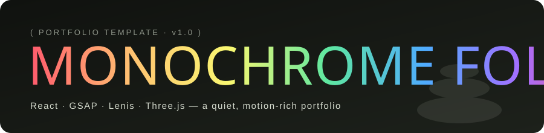
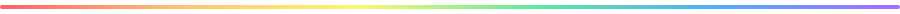
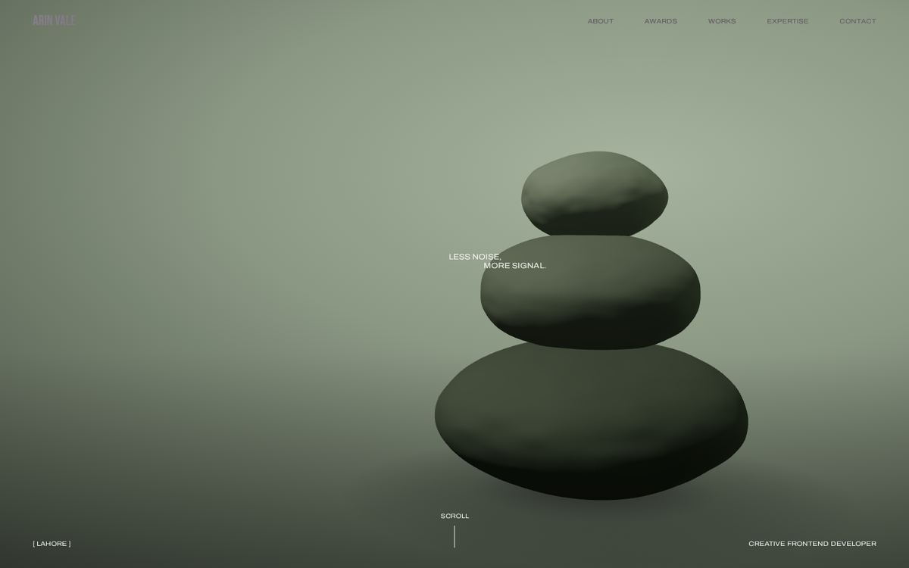
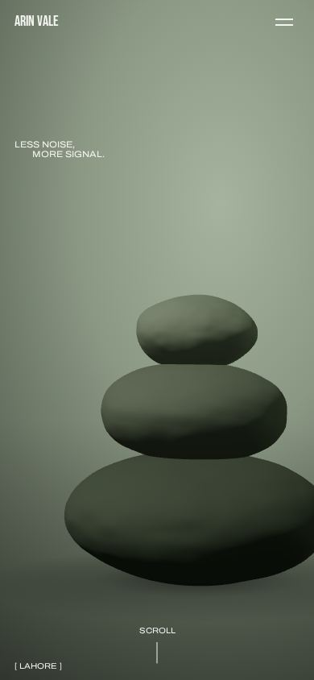
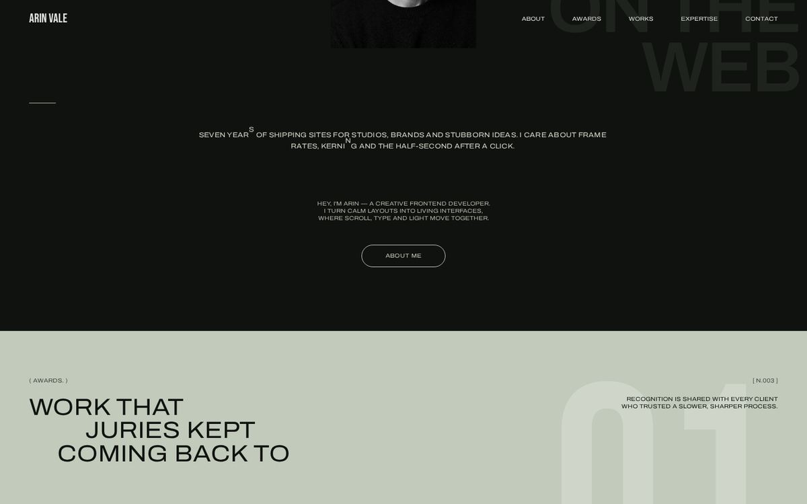
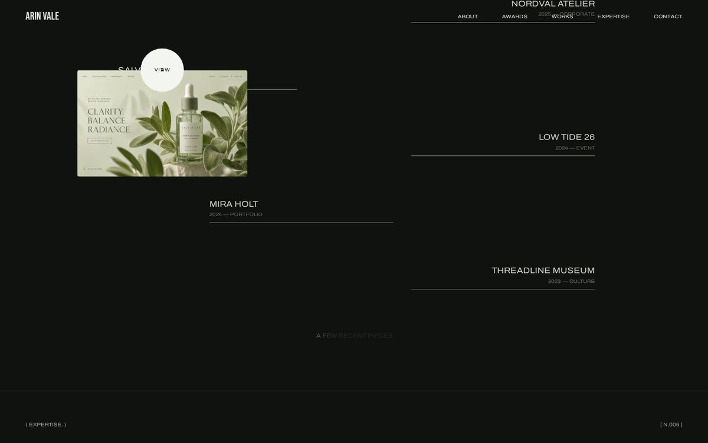
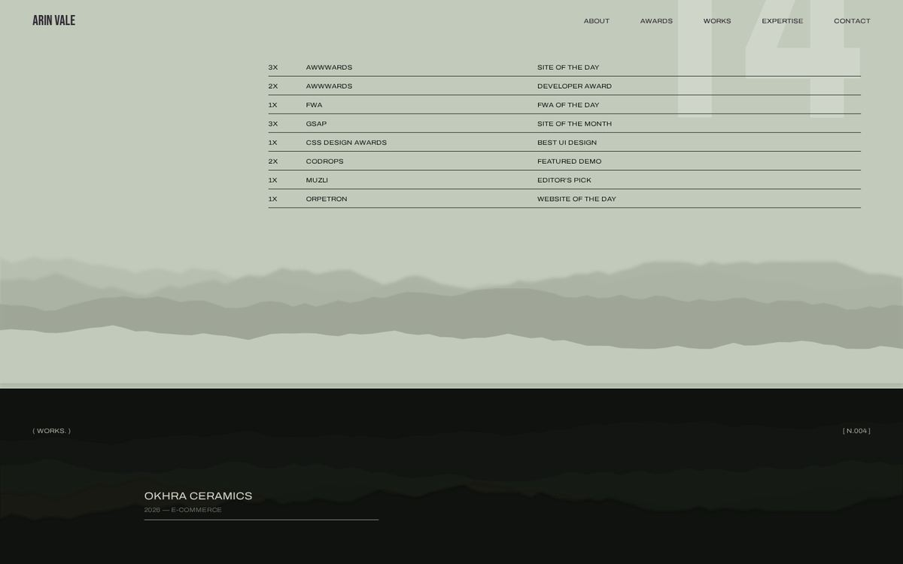
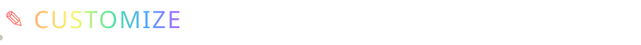

<div align="center">





<p>
  
  
  
  
  
</p>
<p>
  
  
  
  
</p>

**A quiet, motion-rich portfolio template for creative developers.**
<br/>
Sage and charcoal tones, condensed type, and scroll that tells a story.

[Live demo](https://Muhammad112233-creator.github.io/Portfolio-Template-27/) ·
[Quick start](#-quick-start) ·
[Customize](#-customize) ·
[Deploy](#-deploy)

</div>




<table>
  <tr>
    <td width="66%"></td>
    <td width="34%" rowspan="2" align="center"></td>
  </tr>
  <tr>
    <td></td>
  </tr>
  <tr>
    <td></td>
    <td></td>
  </tr>
</table>


|     | Feature              | What it does                                                                                              |
| :-: | -------------------- | --------------------------------------------------------------------------------------------------------- |
|  ◐  | **Preloader**        | Real image and font preloading, a 0 → 100 counter, and a rotating ring of letters that scatters on finish |
|  ▲  | **3D hero**          | A procedural pebble cairn (React Three Fiber) that follows the mouse and sinks as you scroll              |
|  ▤  | **Pinned manifesto** | Letters brighten one by one with scroll, a signature draws itself, and an odometer ticks along            |
|  ✺  | **Letter scatter**   | Loose glyphs fly in from across the screen and land as a sentence                                         |
|  ⓘ  | **Awards table**     | The counter rolls up, lines draw in, and parallax hills drift underneath                                  |
|  ⌖  | **Works list**       | Zig-zag project list; the cover image follows the cursor with inertia and tilt                            |
|  ↻  | **Page transitions** | A sage curtain spells out the destination letter by letter                                                |
|  ●  | **Custom cursor**    | Dot + lagging ring; grows on links, shows “view” on projects, hidden on touch devices                     |
|  ⇅  | **Rolling buttons**  | Pill buttons and nav links whose letters roll up on hover                                                 |
|  ✉  | **Two-step form**    | Validation, then CONFIRM turns into SEND; budget pills; a “sent” page                                     |
|  ⧉  | **Copy email**       | Click the footer email to copy it, with an animated confirmation                                          |
|  ▢  | **Case studies**     | One page per project with a Swiper slider and a “next case” link                                          |
| 📱  | **Responsive**       | Tuned at 1100 / 950 / 768 / 650 / 450 px, with a full-screen mobile menu                                  |
| ♿  | **Reduced motion**   | Respects `prefers-reduced-motion`                                                                         |


```text
React 18            UI + routing (react-router, HashRouter → works on GitHub Pages)
GSAP + ScrollTrigger  every timeline, pin and scrub
@gsap/react         useGSAP() for automatic cleanup
Lenis               inertial smooth scrolling, synced to the GSAP ticker
Three.js + R3F      the 3D cairn in the hero
Swiper              case-study slider
Vite                dev server + production build
Fontsource          self-hosted Bebas Neue + Archivo (variable width)
```


```text
monochrome-folio/
├─ .github/workflows/deploy.yml   ← auto-build & publish to GitHub Pages
├─ docs/readme/                   ← animated SVGs + screenshots for this README
├─ public/                        ← favicon, social share image
├─ src/
│  ├─ assets/img/                 ← portrait + project covers (swap these)
│  ├─ data/content.js             ← ✎ ALL TEXT LIVES HERE
│  ├─ components/                 ← Loader, Header, Cursor, Footer, buttons…
│  ├─ sections/                   ← Hero, Statement, About, Awards, Works, Expertise
│  ├─ pages/                      ← Home, About, Case, Sent, 404
│  ├─ three/Cairn.jsx             ← procedural 3D scene
│  ├─ hooks/                      ← Lenis scroll + page-transition providers
│  └─ styles/                     ← base / sections / pages CSS
├─ index.html
├─ vite.config.js
└─ package.json
```


> Requires **Node.js 18+** ([download](https://nodejs.org)).

```bash
# 1. install
npm install

# 2. run locally → http://localhost:5173
npm run dev

# 3. production build → /dist
npm run build

# 4. preview the build → http://localhost:4173
npm run preview
```




<details open>
<summary><b>1 · Text, links, projects</b></summary>

Open **`src/data/content.js`**. Name, role, email, socials, statement, awards, projects, skills and the about page are all in this one file. Add or remove items in any array and the layout adapts.

</details>

<details>
<summary><b>2 · Images</b></summary>

Replace files in `src/assets/img/` and keep the same names (`portrait.jpg`, `work-1.jpg` … `work-6.jpg`), or import new ones at the top of `content.js`.
Recommended sizes: portrait **1000×1250**, covers **1600×1000**, JPG at around 80% quality.

</details>

<details>
<summary><b>3 · Colours & fonts</b></summary>

Edit the tokens at the top of `src/styles/base.css`:

```css
--ink: #10120f; /* near-black */
--sage: #c2cabb; /* main light tone */
--olive: #3b4039; /* secondary text */
```

</details>

<details>
<summary><b>4 · Contact form</b></summary>

The form validates and goes to `/sent`, but it doesn't send email yet.
To receive messages, create a free form at [formspree.io](https://formspree.io), then in `src/components/ContactForm.jsx` replace the comment inside `send()` with:

```js
await fetch("https://formspree.io/f/YOUR_ID", {
  method: "POST",
  headers: { "Content-Type": "application/json", Accept: "application/json" },
  body: JSON.stringify({ ...f, budget: contact.budgets[budget] }),
});
```

</details>

<details>
<summary><b>5 · 3D object</b></summary>

`src/three/Cairn.jsx` → edit the `STONES` array (size, colour, roughness) or swap in your own mesh.

</details>


- Code, copy and imagery are original to this template; the portrait and project covers are AI-generated placeholders, so replace them with your own work.
- Fonts: [Bebas Neue](https://fonts.google.com/specimen/Bebas+Neue) and [Archivo](https://fonts.google.com/specimen/Archivo), both under the SIL Open Font License.
- Released under the **MIT License**. Use it, ship it, sell client work with it. A star ⭐ is appreciated.

<div align="center">
<br/>

<br/>
<sub>Made slowly, by hand · <b>Arin Vale</b> · Lahore</sub>
</div>

<div align="center">

## 🌟 Support the Project

If you find this template useful, please consider giving it a star! It helps others discover the repository and supports future development.

</div>


